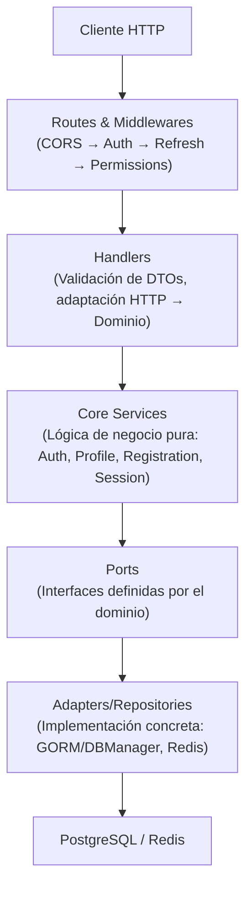

# API Go - Arquitectura Hexagonal

Backend robusto y seguro desarrollado en Go, siguiendo los principios de Arquitectura Hexagonal (Puertos y Adaptadores) y Clean Architecture. Diseñado para ser desplegado de forma contenida y segura mediante Podman/Docker Compose con un proxy inverso (Caddy).

---

## 📁 Estructura del Proyecto

``` bash
template-nest/
├── 📄 Dockerfile                  # Imagen multi-etapa, ejecución como usuario no-root
├── 📄 Makefile                    # Comandos de automatización
├── 📄 docker-compose.yml          # Orquestación de servicios (Backend, Redis, Postgres)
├── 📄 go.mod / go.sum             # Dependencias del proyecto
├── 📁 cmd/api/
│   └── 📄 main.go                 # Punto de entrada y configuración del servidor HTTP
├── 📁 config/
│   └── 📄 config.go               # Carga de variables de entorno y configuración
├── 📁 internal/
│   ├── 📁 app/                    # Inicialización y orquestación de dependencias (Wire)
│   ├── 📁 core/                   # 🧠 Dominio: Lógica de negocio pura, independiente de frameworks
│   │   ├── 📁 auth/               # Servicio de autenticación (Login, validación de cookies)
│   │   ├── 📁 profile/            # Servicio de gestión de perfiles de usuario
│   │   ├── 📁 registration/       # Servicio de registro y creación de usuarios
│   │   ├── 📁 session/            # Servicio de gestión de sesiones (Refresh, Logout)
│   │   ├── 📁 estados/            # Lógica de negocio de estados
│   │   ├── 📁 permisos/           # Lógica de negocio de permisos
│   │   ├── 📁 roles/              # Lógica de negocio de roles
│   │   └── 📁 usuarios/           # Lógica de negocio de usuarios
│   ├── 📁 infrastructure/         # 🔌 Adaptadores: Implementaciones concretas de los puertos
│   │   ├── 📁 adapters/           # Adaptadores que implementan los puertos del core (BD + Cache)
│   │   ├── 📁 cookies/            # Firmado y verificación de cookies
│   │   ├── 📁 database/           # Conexión a PostgreSQL y DBManager (abstracción GORM)
│   │   ├── 📁 jwt/                # Generación y validación de tokens JWT
│   │   ├── 📁 redis/              # Cliente de caché y gestión de sesiones
│   │   └── 📁 repositories/       # Implementaciones de acceso a datos
│   └── 📁 interfaces/             # 🌐 Capa de entrada: Adaptadores HTTP
│       └── 📁 api/
│           ├── 📁 common/         # Respuestas estandarizadas y validación
│           ├── 📁 handlers/       # Controladores HTTP (mapeo Request → DTO → Service)
│           ├── 📁 middlewares/    # CORS, Auth, Refresh, Permissions, Logging, Recovery
│           └── 📁 routes/         # Definición de endpoints y encadenamiento de middlewares
├── 📁 pkg/                        # 🛠️ Utilidades transversales (Logger, Validadores, Password)
└── 📁 scripts/                    # Scripts de apoyo (ej. generación de secrets)
```

---

## 🔄 Flujo de Datos (Arquitectura Hexagonal)



---

## 🚀 Despliegue y Ejecución

El proyecto está optimizado para ejecutarse de forma aislada utilizando redes internas, exponiendo únicamente el puerto del proxy inverso al exterior.

### 1. Variables de Entorno
Crea un archivo `.env` en la raíz del proyecto basado en `.env.template`:
```env
# Base de Datos
HOST_DB=postgres
PORT_DB=5432
USER_DB=postgres
PASS_DB=tu_contraseña_segura
NAME_DB=myapp

# Redis
REDIS_URL=redis://:tu_contraseña_redis@redis:6379/0
REDIS_PASSWORD=tu_contraseña_redis
REDIS_TTL=3600

# Auth & Sessions
JWT_SECRETO=clave_secreta_de_al_menos_32_caracteres
JWT_SALT=10
JWT_TIEMPO_EXPIRA=3600
SESSION_TTL=3600
REFRESH_THRESHOLD=300
COOKIE_SECRET=clave_secreta_para_firmar_cookies_32_chars

# App
ENV=Production
PORT=8080
CORS_ALLOWED_ORIGINS=https://mrciro.com,https://www.mrciro.com,https://api.mrciro.com,trycloudflare.com
```

### 2. Construcción y Despliegue (Podman / Docker)
```bash
# Construir la imagen (asegura capa final minimalista y usuario no-root)
podman build -t go-api:latest .

# Levantar la pila de servicios en segundo plano
podman-compose up -d

# Verificar estado de los contenedores
podman-compose ps

# Ver logs en tiempo real
podman-compose logs -f go_backend
```

---

## 🛡️ Optimizaciones de Seguridad Implementadas

1. **Ejecución como Usuario No-Root:** El `Dockerfile` utiliza un multi-stage build y cambia al usuario `appuser` (UID 1001) antes de ejecutar el binario, mitigando riesgos en caso de compromiso del contenedor.
2. **Context Keys Tipadas:** Las claves del contexto (`UserKey`, `UserIDKey`) utilizan un tipo personalizado (`contextKey`) para evitar colisiones silenciosas con librerías de terceros.
3. **Aislamiento de Red:** Los servicios de base de datos y caché (`postgres`, `redis`) solo son accesibles a través de la red interna `app_internal`. No exponen puertos al host (`0.0.0.0`).
4. **CORS Estricto:** El middleware de CORS valida explícitamente los orígenes permitidos (incluyendo soporte seguro para `trycloudflare.com`), rechazando cualquier origen no listado.
5. **Segregación de Responsabilidades (ISP):** El monolítico `AuthService` ha sido dividido en `ProfileService`, `RegistrationService` y `SessionService`, reduciendo la superficie de ataque y mejorando la mantenibilidad.
6. **Cero Secrets en la Imagen:** Las credenciales se inyectan exclusivamente en tiempo de ejecución mediante variables de entorno, nunca se copian al sistema de archivos de la imagen final.

---

## ⚒️ Comandos Útiles

### Gestión de Contenedores
```bash
# Reiniciar únicamente el backend (útil tras cambios de código)
podman-compose restart go_backend

# Acceder a una shell dentro del contenedor de la API
podman exec -it go_backend /bin/sh

# Acceder a la consola de PostgreSQL
podman exec -it postgres-service-1 psql -U postgres -d myapp
```

### Limpieza Profunda (Reset de Estado)
```bash
# Detener servicios y eliminar volúmenes de datos (⚠️ Borra la BD y Redis)
podman-compose down -v

# Eliminar imágenes huérfanas y caché de construcción
podman image prune -a -f
```

---

## 📋 Modificación de Campos de Autenticación (Ejemplo: Email)

Si se requiere cambiar el identificador principal de autenticación (ej. de `Username` a `Email`), los únicos archivos que deben modificarse son:

1. **`internal/core/auth/ports.go`**: Actualizar el struct `AuthData`.
2. **`internal/core/login/service.go`**: Actualizar `LoginCredentials` y la llamada al puerto.
3. **`internal/infrastructure/repositories/usuario_repository.go`**: Modificar la consulta `FindByEmail` o `FindByUsername` en el `DBManager`.
4. **`internal/interfaces/api/handlers/login/handler.go`**: Actualizar el DTO `LoginRequestDTO` y su validación.

*El resto de la arquitectura (Middlewares, Core Services, Routes) permanece inalterada gracias al desacoplamiento de los Puertos.*